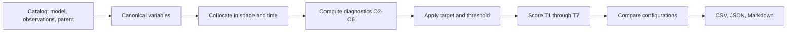

# LAUT

**Local Assessment for Upper-ocean Tropical ocean processes** is an evaluation
toolbox for rapidly comparing regional ocean-model configurations and
observations in Southeast Asia.

LAUT is intended to play the same practical role for this region that COAsT
plays for high-resolution ocean-model assessment: make heterogeneous model and
observational data easier to load, collocate, diagnose, and compare. LAUT adds a
region-specific acceptance scorecard for SST, thermocline structure, salinity,
sea level, tides, the Indonesian Throughflow, marine heatwaves, mesoscale
value-add, and long-term drift.

> **Scientific status:** the bundled thresholds are a **proposal**, faithfully
> transcribed from the 13 July 2026 expanded acceptance framework. They must be
> calibrated against the existing 20-year CCRS-NEMO-SEA hindcast before they are
> treated as an operational standard.

## What works in v0.1

- A versioned, machine-readable implementation of stages S0-S4, ocean criteria
  O2-O6, and the tuning hierarchy T1-T7.
- Fast comparison from a long-form diagnostics CSV.
- A catalog-driven pipeline for local NetCDF/CSV/NPZ, OPeNDAP, and Zarr data.
- xarray-based exact, inner, nearest, or interpolated model-observation
  collocation when the optional ocean dependencies are installed.
- Bias, RMSE, pattern correlation, absolute/relative error, factor agreement,
  and parent-model MSE skill score.
- CSV, JSON, and Markdown reports that preserve every diagnostic, threshold
  result, missing value, and configuration rank.
- A hierarchy-aware comparison: T1 is considered before T2, and so on. Strong
  lower-priority mesoscale performance cannot conceal a weak SST mean state.

## Quick start

```console
python -m venv .venv
source .venv/bin/activate
pip install -e '.[ocean,test]'
laut validate-framework
python examples/synthetic_demo.py --output outputs/demo
```

The demonstration compares three complete synthetic configurations and writes:

```text
outputs/demo/
├── configuration-ranking.csv
├── diagnostic-results.csv
├── laut-results.json
└── summary.md
```

To evaluate diagnostics already calculated by another workflow:

```console
laut evaluate diagnostics.csv --stage S4 --output outputs/experiment-07
```

The input is deliberately simple:

```csv
configuration,stage,mode,criterion_id,value
control,S4,forced,O2_SST_BIAS,0.62
control,S4,forced,O2_SST_RMSE,0.58
experiment-07,S4,forced,O2_SST_BIAS,0.31
experiment-07,S4,forced,O2_SST_RMSE,0.46
```

Missing required diagnostics remain visible and prevent an acceptance decision.

## Connect model and observational data

Create an editable framework, source catalog, and run-manifest template:

```console
laut init-config evaluation-01
```

The catalog maps each provider's names onto canonical LAUT variables:

```toml
[[sources]]
id = "candidate"
driver = "netcdf"
uri = "/data/nemo/candidate_grid_T_1995-2014.nc"
variables = {sst = "sosstsst", sea_surface_salinity = "sosaline"}
coordinates = {time = "time_counter", latitude = "nav_lat", longitude = "nav_lon"}

[[sources]]
id = "ostia"
driver = "opendap"
uri = "https://authorised-endpoint.example/dataset"
variables = {sst = "analysed_sst"}
offset = {sst = -273.15}
```

The run manifest then connects a criterion to sources:

```toml
[[evaluations]]
configuration = "candidate"
criterion_id = "O2_SST_RMSE"
model_source = "candidate"
reference_source = "ostia"
variable = "sst"
alignment = "interp"
```

Run it with `laut run evaluation-01/run.toml`. Complex diagnostics such as ITF
transport, tidal harmonics, marine-heatwave statistics, an eddy census, or heat
budget closure can be supplied as precomputed scalar values in the same
manifest. This keeps LAUT interoperable with specialist tools instead of
forcing one implementation of every process diagnostic.

## Evaluation logic



The weighted score is useful for communication but does **not** determine the
ordering. Configurations are sorted lexicographically by T1, T2, ... T7. Final
acceptance additionally requires:

1. Stage S4 output;
2. complete coverage of required criteria; and
3. no required criterion outside its threshold.

## Project map

- [`src/laut/resources/laut-sea-v0.1.0.toml`](src/laut/resources/laut-sea-v0.1.0.toml)
  is the proposed scientific scorecard.
- [`docs/framework.md`](docs/framework.md) maps the source document onto LAUT.
- [`docs/data-sources.md`](docs/data-sources.md) describes adapters and access
  responsibilities.
- [`docs/architecture.md`](docs/architecture.md) explains extension points.
- [`docs/roadmap.md`](docs/roadmap.md) distinguishes this tested foundation from
  the specialist diagnostics still to be implemented.
- [`CONTRIBUTING.md`](CONTRIBUTING.md) describes how to add a metric, source, or
  calibrated framework version.

## Scope and relationship to COAsT

LAUT borrows the proven pattern of xarray-backed loading, canonical variable
mapping, subsetting/collocation, reusable diagnostics, and examples. It is not a
fork or drop-in replacement for COAsT. COAsT can remain a specialist engine for
profiles, tide gauges, and gridded NEMO analysis while LAUT supplies the
Southeast Asian process scorecard and configuration-ranking workflow.

## License

BSD 3-Clause. Observational datasets retain their own access conditions,
licenses, and citation requirements; LAUT does not redistribute them.
