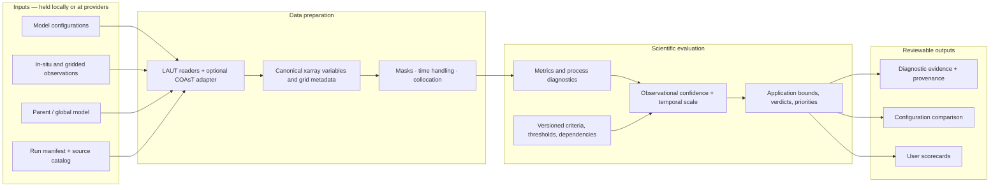

# LAUT architecture

LAUT turns regional ocean observations and model output into traceable diagnostics,
evaluation evidence, configuration comparisons, and application scorecards. The
architecture keeps data handling separate from scientific policy so new data
sources and process diagnostics can be added without silently changing the
framework.

## Architecture at a glance



## Repository responsibilities

| Layer | Responsibility | Current home |
|---|---|---|
| Source definitions | Local/remote source locations, provider variable names, units and open options | `src/laut/catalog.py`, TOML catalogs |
| Canonical data | Common variable names and consistent coordinate/dimension expectations | `src/laut/catalog.py`; expanded data contract is planned |
| Alignment | Time/space selection and model-reference collocation | `src/laut/catalog.py` (`align_arrays`) |
| Diagnostics | Small reusable metrics; specialist process algorithms can be separate packages | `src/laut/metrics.py` |
| Scientific policy | Versioned criteria, thresholds, stages, applicability and priorities | `src/laut/framework.py`, `src/laut/resources/` |
| Evidence | Per-criterion value, status, units and reason | `src/laut/criteria.py` |
| Comparison | T1–T7 priority ranking and acceptance completeness | `src/laut/ranking.py` |
| Run orchestration | Manifest evaluation and precomputed diagnostic ingestion | `src/laut/pipeline.py`, `src/laut/cli.py` |
| Reports | CSV, JSON and Markdown outputs | `src/laut/report.py` |

Keep this as a modular Python package for now. Create subpackages such as
`laut.io`, `laut.diagnostics`, or `laut.scorecards` when a layer has enough
independent code to benefit; do not split modules just to mirror a diagram.

## COAsT relationship

COAsT should be an optional data and specialist-diagnostics integration, not a
dependency of the scorecard rules. Where available, accept COAsT's xarray-backed
objects/datasets and preserve its NEMO grid identity (T/U/V/F), domain fields,
coordinates, and lazy access. Convert into LAUT's canonical variable contract at
the adapter boundary. Plain xarray inputs and precomputed diagnostic values
should remain valid, so users can run LAUT without COAsT.

This follows COAsT's documented emphasis on xarray datasets, standardised
variables/dimensions, grid-aware objects, and lazy loading. See the [COAsT code
structure guide](https://british-oceanographic-data-centre.github.io/COAsT/docs/contributing/contributing-package/code_structure/)
and [Gridded reference](https://british-oceanographic-data-centre.github.io/COAsT/docs/reference/gridded/).

## Map from the scorecard concept

The scorecard separates evidence quality from model performance:

1. **Observational confidence** records coverage, sampling, record length,
   independence, and the resulting high/medium/low evidence class.
2. **Temporal scale** records which claims the observations support: mean state,
   seasonal, interannual, or event scale.
3. **Diagnostics and processes** compute or ingest quantities such as SST bias,
   thermocline depth, transport, marine heatwaves, and mesoscale activity.
4. **Application dependencies** state which targets each application needs.
5. **Application verdicts** are bounded by the weakest required evidence and
   report verifiable, partly verifiable, or unverified.

| Scorecard concept | Status in this repository |
|---|---|
| Criteria and threshold evaluation | Implemented for the bundled proposal framework |
| Configuration ranking and missing-criterion visibility | Implemented |
| Precomputed or basic gridded diagnostic input | Implemented |
| Regional masks and full process diagnostics | Planned; see `docs/roadmap.md` |
| Observation confidence (H/M/L) and temporal-scale evidence | Design target; not yet a computed score |
| Application dependency matrix and weakest-link verdict | Design target; not yet emitted by reports |
| Provenance-rich user scorecards | Partial: results are emitted, full run provenance and application view remain planned |

The current synthetic example demonstrates framework evaluation and ranking. It
does not yet claim to implement the full H/M/L observation-confidence matrix in
the concept image.

## Run a collaborator demonstration

From the repository root, run:

```console
python -m pip install -e .
laut validate-framework
python examples/synthetic_demo.py --output outputs/demo
```

The synthetic walkthrough only needs LAUT's core install; the optional ocean
dependencies are not needed. It requires no observational data and creates diagnostic records, a
configuration ranking, JSON output, and a Markdown summary under `outputs/demo/`.
Use the synthetic values to demonstrate how a proposal framework makes evidence
visible and how higher-priority weaknesses affect ranking. Do not present the
synthetic outcome as a scientific model evaluation.

Suggested talking point: the synthetic `eddy-first` configuration improves a
lower-priority rank but fails a T1 criterion, so it falls behind `control`. This
shows why LAUT keeps the priority ordering visible instead of letting one
aggregate number hide the trade-off.

## Data contract and reproducibility

For a local-observation run, a source catalog maps provider names to canonical
LAUT variables; a run manifest names the model, reference, optional parent,
criterion, and alignment method. Keep large data and credentials outside Git.
Commit the framework version, example configuration, code, and documentation.

As the data contract matures, each run should record source identifiers and
versions, evaluation period, variable and unit mapping, masks, temporal
aggregation, calendar handling, collocation/regridding method, uncertainty
assumptions, software version, and git revision. These choices are part of the
scientific result, not just execution details.

## Extension contracts

### Add a diagnostic

Implement a documented function with explicit units and missing-data behavior;
register it with the metrics interface or package a specialist algorithm
separately. Keep the algorithm distinct from thresholds so one diagnostic can
support multiple frameworks.

### Add a source or COAsT adapter

Return canonical xarray arrays/datasets while preserving relevant coordinates,
grid metadata, masks, and lazy behavior. Keep provider credentials outside
catalog files committed to Git.

### Change scorecard policy

Publish a new framework version with its calibration period, references,
uncertainties, and scientific rationale. Never silently change thresholds in a
released version.
